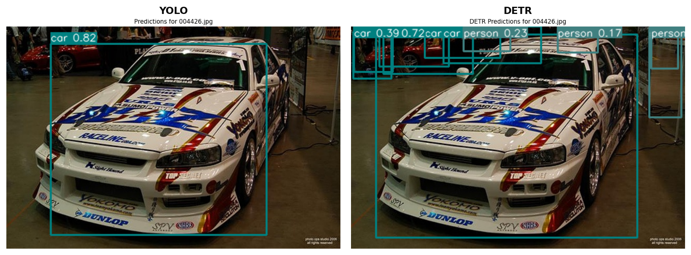
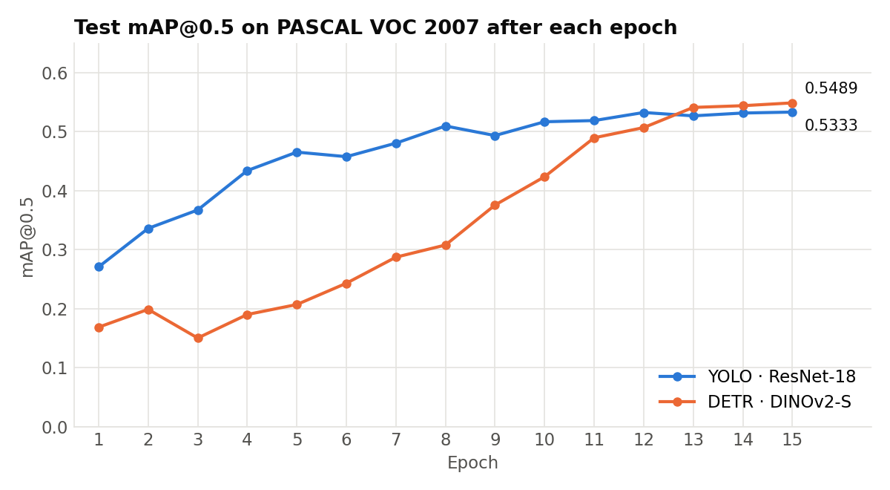
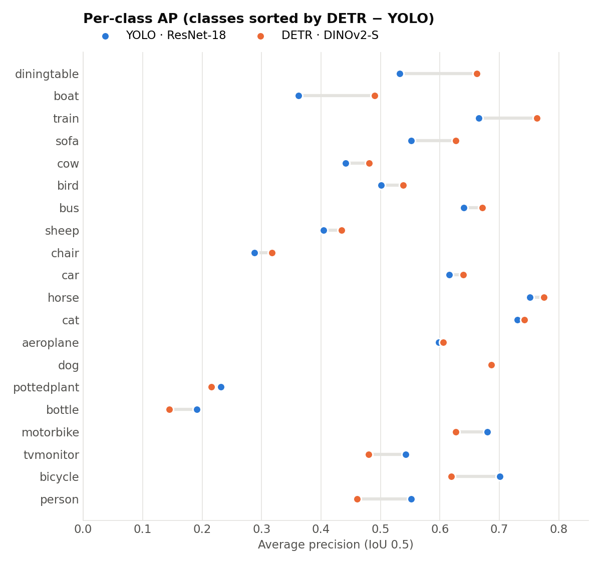
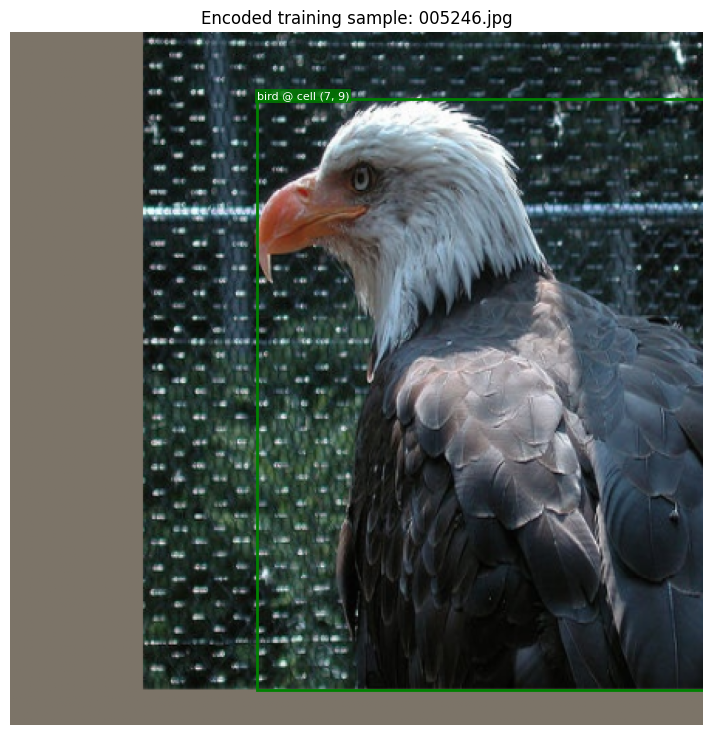
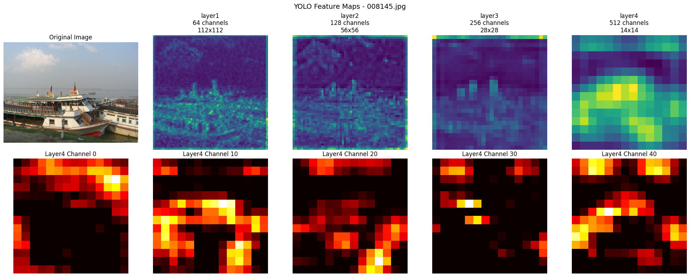
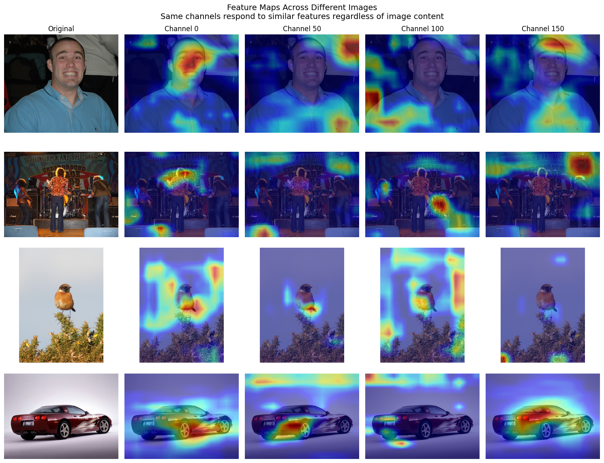

# YOLO vs DETR: Grid-Based vs Set-Based Object Detection

**Two object detectors trained on PASCAL VOC 2007 and compared head to head: a YOLO-style CNN detector (ResNet-18) and a DETR-style transformer detector (DINOv2 + Hungarian matching).**



## The problem

Object detection means predicting *what* is in an image and *where* it is, as class labels plus bounding boxes. There are two families of solutions:

- **YOLO (grid-based, dense):** split the image into an S×S grid; each cell predicts a few boxes and class scores. Duplicate detections are removed afterwards with Non-Maximum Suppression (NMS).
- **DETR (set-based, end-to-end):** a transformer decoder predicts a fixed-size *set* of boxes. During training, a Hungarian algorithm matches each ground-truth object to exactly one prediction, so NMS is not needed.

This project implements the core of both (losses, the transformer detection head, the matching loss) and compares them on the same data, the same 15-epoch budget and the same evaluation.

## Results

Evaluated on the **VOC 2007 test set (4,950 images)** with mAP@0.5 (VOC07 11-point metric).

| Detector | Backbone | Params | Optimizer | Train time (15 epochs, Colab GPU) | **Test mAP@0.5** | Kaggle (held-out) |
|---|---|---|---|---|---|---|
| YOLO | ResNet-18 (ImageNet) | 32.50M | SGD + cosine LR | 5,612 s (~1.6 h) | **0.5333** | 0.5069 |
| DETR | DINOv2-S with registers | 28.35M | AdamW | 7,945 s (~2.2 h) | **0.5489** | 0.5248 |



**Takeaways**

- **DETR starts slower but finishes higher.** After epoch 1 YOLO is at 0.27 mAP and DETR at 0.17. DETR only overtakes at epoch 13, when it reaches 0.541 against 0.527 for YOLO. This is the known slow convergence of set-based detectors: the Hungarian matching keeps reassigning which query is responsible for which object early in training.
- **Neither model wins everywhere.** DETR is much better on *large, context-dependent* objects (diningtable +0.13 AP, boat +0.13, train +0.10). YOLO is better on *frequent or small* classes (person +0.09, bicycle +0.08, tvmonitor +0.06, bottle +0.05). With only 12 object queries per image, DETR is likely at a disadvantage on crowded `person` scenes.
- **Learning rates are architecture-specific.** Raising YOLO's backbone LR from 5e-5 to 1e-4 lifted mAP from 0.51 to 0.5333. The same increase on DETR's DINOv2 backbone (7e-5 or 1e-4) made training unstable, so the final DETR run uses 5e-5 plus a backbone freeze during the first 2 epochs.



## Approach

### YOLO (`src/yolo_loss.py`)
- ImageNet ResNet-18 backbone and a detection head on a **14×14 grid**. Each cell predicts **B = 2** boxes `(x, y, w, h, conf)` plus 20 class scores, from 448×448 input.
- **Loss (written from scratch):** for every cell that contains an object, pick the *responsible* predictor (the one of the B boxes with the highest IoU with the ground truth), then sum:
  - coordinate regression on `(x, y)` and on `(√w, √h)`, weighted by λ_coord = 5. The square root makes errors on small boxes count more.
  - object confidence regressed toward the (detached) IoU of the responsible box.
  - no-object confidence on every other predictor, weighted by λ_noobj = 0.05.
  - class-probability MSE on object cells.

<p align="center"><br><em>A training sample encoded into the 14×14 YOLO target grid.</em></p>

### DETR (`src/detr.py`, `src/detr_loss.py`)
- A **DINOv2-S** Vision Transformer produces patch features. A 1×1 conv projects them to d_model = 256, and sine positional embeddings are added.
- A **Transformer encoder-decoder** (1 encoder layer, 3 decoder layers, 8 heads) takes **12 learned object queries**. Each query has two heads: a linear class head (20 classes + "no object") and a 3-layer MLP box head.
- **Set-prediction loss:** a Hungarian matcher assigns ground-truth boxes to queries. The loss is cross-entropy with a down-weighted "no object" class, plus **L1 + Generalized IoU** on the matched boxes.

### What does the CNN see?
Forward hooks on the trained YOLO backbone show how features go from edges and textures (layer 1, 112×112) to object-level activations (layer 4, 14×14). Some channels respond to the same parts across different images:




## What we implemented

The course provided the data pipeline (VOC loading, augmentation, target encoding), the backbones, the evaluation and mAP code, the inference and NMS code, and the training loops. We implemented:

- `src/yolo_loss.py`: the full YOLO loss (responsible-box selection by IoU, box conversion, all five loss terms, empty-batch edge cases).
- `src/detr.py`: the `SimpleDETR` model (input projection, Transformer, query embeddings, class and box heads, forward pass).
- `src/detr_loss.py`: the classification loss with no-object weighting, the L1 + GIoU box losses, and the Hungarian-matching criterion.
- The hyperparameter search on backbone learning rates, and the feature-map visualizations in `notebooks/01_yolo.ipynb`.

## Repository structure

```
├── src/
│   ├── yolo.py, backbones.py, dataset.py, eval.py, predict.py, constants.py   # course-provided pipeline
│   ├── yolo_loss.py                     # YOLO loss (implemented)
│   ├── detr.py                          # SimpleDETR model (implemented)
│   └── detr_loss.py                     # Hungarian set-prediction loss (implemented)
├── notebooks/
│   ├── 01_yolo.ipynb                    # training, predictions, feature maps, evaluation (with outputs)
│   └── 02_detr.ipynb                    # training, predictions, evaluation (with outputs)
├── scripts/download_data.sh             # downloads PASCAL VOC 2007
├── results/                             # figures + metrics_log.json (raw per-epoch mAP and per-class AP)
├── requirements.txt
└── LICENSE
```

## How to run

```bash
git clone https://github.com/PabloCarreras7/yolo-vs-detr-object-detection.git
cd yolo-vs-detr-object-detection
pip install -r requirements.txt

bash scripts/download_data.sh data/VOC      # ~900 MB, PASCAL VOC 2007 trainval + test
jupyter notebook notebooks/01_yolo.ipynb     # then notebooks/02_detr.ipynb
```

A GPU is required in practice (Google Colab works). Checkpoints are written to `runs/`, which git ignores.

## Data

- **PASCAL VOC 2007** (trainval: 5,011 images; test: 4,952 images, of which 4,950 are evaluated) comes from the [official site](http://host.robots.ox.ac.uk/pascal/VOC/voc2007/) via `scripts/download_data.sh`.
- The notebooks read flat annotation lists (`annotations/voc2007.txt`, `annotations/voc2007test.txt`, one line per image: `file x1 y1 x2 y2 class …`). These were provided by the course and are not redistributed here. They are a plain-text conversion of the VOC XML annotations.

## What I learned

- The practical difference between *dense prediction + NMS* and *set prediction + bipartite matching*, and why the latter needs more training before it pays off.
- How the design of a loss changes behavior: √w/√h for scale invariance, the λ_noobj imbalance term, and GIoU giving useful gradients even when boxes do not overlap.
- Reading per-class AP instead of a single mAP number: the two detectors fail in different places, which a single average hides.
- Fine-tuning pretrained backbones: a CNN backbone tolerated (and benefited from) a higher learning rate, while a self-supervised ViT backbone needed a lower rate and a warm-up freeze.

## Acknowledgements and transparency

This project was completed as a **team of two (Pablo Carreras Franca and Felipe Grima Rodriguez)** for **CS 444: Deep Learning for Computer Vision at the University of Illinois Urbana-Champaign (Spring 2026)**. The starter code and data pipeline are by the course staff. I used **Claude Code** as an AI assistant.

References: Redmon et al., *YOLO* (2016) · Carion et al., *DETR* (2020) · Oquab et al., *DINOv2* (2023) · Rezatofighi et al., *GIoU* (2019).

## License

[MIT](LICENSE)
